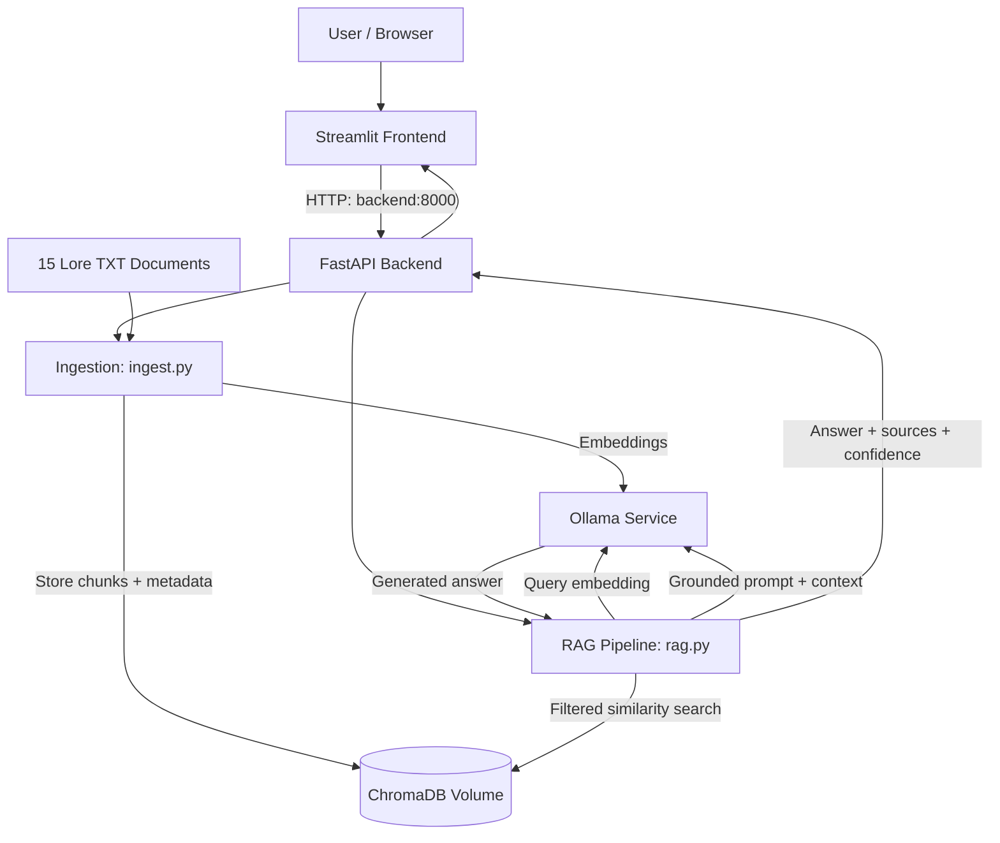

# The Fantasy Archives

**A containerized, document-grounded fantasy-lore chatbot built with FastAPI, Streamlit, ChromaDB, Ollama, and Docker Compose.**

The Fantasy Archives is my AI Systems Engineering Bootcamp RAG capstone project. It lets users ask questions about five fictional universes and receive answers generated from a curated collection of lore documents, with source references and retrieval-strength indicators.

**Spoiler warning:** The knowledge base covers full-series lore, including major plot twists, character deaths, and endings.

## Features

- **Five searchable universes:** The Lord of the Rings, Red Rising, Mistborn, Harry Potter, and The Chronicles of Narnia.
- **15 original reference documents:** Three topic-focused `.txt` files per universe, with full-spoiler coverage.
- **Retrieval-augmented answers:** The backend searches ChromaDB for relevant passages before requesting an answer from Ollama.
- **Universe filtering:** Search one fictional world or compare material across all five.
- **Source citations:** View source file paths, chunk numbers, and cosine-similarity scores in expandable Streamlit sections.
- **Conversational interface:** Streamlit chat messages, input, and a separate in-session conversation history for each universe.
- **Health and indexing controls:** The sidebar displays backend/Ollama status, indexed chunks and files, and a re-index button.
- **Safer re-indexing:** A new index is built and checked before it replaces the active ChromaDB collection.
- **Automated quality checks:** Pytest, live API evaluation, and a GitHub Actions workflow for tests and Docker builds.

## Tech Stack

| Component | Technology | Purpose |
| --- | --- | --- |
| Frontend | Streamlit | Chat interface and system controls |
| Backend | FastAPI | API endpoints and RAG orchestration |
| Vector database | ChromaDB | Persistent embeddings and semantic retrieval |
| Language model | Ollama / `llama3.2:1b` | Local answer generation |
| Embedding model | Ollama / `nomic-embed-text` | Document and question embeddings |
| Containers | Docker Compose | Three connected services |
| Testing | Pytest | Offline backend tests |
| Evaluation | Python standard library | Live API checks and Markdown report |
| CI | GitHub Actions | Backend tests and Docker image builds |

## Architecture



The application runs in three Docker Compose services: `frontend`, `backend`, and `ollama`. ChromaDB is embedded in the backend and saved to a named Docker volume. Ollama models are stored in a separate named volume.

### How a question is answered

1. Documents are discovered recursively under `backend/docs/` and split into overlapping chunks.
2. Ollama creates an embedding for each chunk; ChromaDB stores vectors plus source and universe metadata.
3. A user selects a universe and asks a question in Streamlit.
4. FastAPI embeds the question and queries ChromaDB, applying a series filter when selected.
5. Passages below the configured similarity threshold are excluded.
6. Ollama receives the question, relevant passages, and instructions to answer using only the supplied context.
7. Streamlit displays the answer, retrieval-strength label, and expandable source references.

## Project Structure

```text
fantasy-rag-assistant/
├── .github/
│   └── workflows/
│       └── ci.yml
├── backend/
│   ├── docs/
│   │   ├── lord_of_the_rings/      # 3 documents
│   │   ├── red_rising/             # 3 documents
│   │   ├── mistborn/               # 3 documents
│   │   ├── harry_potter/           # 3 documents
│   │   └── narnia/                 # 3 documents
│   ├── tests/
│   │   ├── test_api.py
│   │   ├── test_ingest.py
│   │   └── test_rag.py
│   ├── Dockerfile
│   ├── config.py
│   ├── ingest.py
│   ├── main.py
│   ├── rag.py
│   └── requirements.txt
├── frontend/
│   ├── Dockerfile
│   ├── app.py
│   └── requirements.txt
├── tools/
│   ├── validate_corpus.py
│   └── evaluate_rag.py
├── docs/
│   ├── CORPUS_MANIFEST.md
│   └── EVALUATION.md              # Generated by evaluation script
├── docker-compose.yml
├── .env.example
├── .gitignore
└── README.md
```

## Getting Started

### Requirements

- Docker Desktop running in **Linux containers** mode (Windows users can use the WSL 2 backend).
- Docker Compose (included with modern Docker Desktop).
- Internet connection for the initial image and model downloads.
- Python 3.11 for local testing and evaluation (not required to run the containerized application).

### 1. Configure environment variables

Open PowerShell in the project root, then create a local configuration file:

```powershell
Copy-Item .env.example .env
```

The default configuration is similar to:

```dotenv
OLLAMA_URL=http://ollama:11434
MODEL_NAME=llama3.2:1b
EMBED_MODEL=nomic-embed-text
CHROMA_PATH=/app/chroma_data
DOCS_PATH=/app/docs
MAX_RESULTS=5
CONFIDENCE_THRESHOLD=0.65
DEBUG=false
```

`OLLAMA_URL` uses Docker's internal service name, not `localhost`. The local `.env` is intentionally excluded from Git; `.env.example` is the shareable template.

### 2. Build and start the services

```powershell
docker compose up --build -d
docker compose ps
```

The app exposes:

| Interface | Address |
| --- | --- |
| Streamlit | http://localhost:8501 |
| FastAPI documentation | http://localhost:8000/docs |
| Backend health | http://localhost:8000/health |
| Index statistics | http://localhost:8000/stats |

Ollama is available to other containers at `http://ollama:11434`; it is deliberately **not published to a Windows host port** to avoid conflicts with another local Ollama installation.

### 3. Pull the two Ollama models (first run)

```powershell
docker compose exec ollama ollama pull llama3.2:1b
docker compose exec ollama ollama pull nomic-embed-text
docker compose exec ollama ollama list
```

These downloads are required once per new Ollama Docker volume. Later starts use the saved models.

### 4. Index the lore documents

The first ingestion can take several minutes because Ollama must generate embeddings for all chunks. From the project root:

```powershell
Invoke-RestMethod -Uri http://localhost:8000/ingest -Method Post -TimeoutSec 900
Invoke-RestMethod http://localhost:8000/stats
```

For the complete corpus, `source_files` should be **15**. The `document_count` value counts **indexed chunks**, not original files, and should be larger than 15. The statistics endpoint also reports chunks per universe.

Future indexing can be triggered with **Re-index Documents** in the Streamlit sidebar. The indexing process builds a replacement collection first and activates it only after verification.

### 5. Start chatting

Open **http://localhost:8501**. Select a universe in the sidebar, ask a question, and expand **Sources** below an answer to inspect the retrieved document references.

Try these questions:

| Universe | Example question |
| --- | --- |
| Lord of the Rings | Why was Frodo unable to destroy the One Ring himself? |
| Red Rising | How does the Color hierarchy maintain the Society's power? |
| Mistborn | How do Allomancy, Feruchemy, and Hemalurgy differ? |
| Harry Potter | Why did the Elder Wand ultimately belong to Harry? |
| Narnia | What is the difference between the Deep Magic and Deeper Magic? |
| All universes | Compare Allomancy in Mistborn with the magic of Narnia. |

Conversation history is maintained separately for each universe **within the current Streamlit session**. It is not a permanent chat database, and individual questions are sent to the RAG endpoint without previous turns as model context.

## API Reference

| Method | Endpoint | Description |
| --- | --- | --- |
| `GET` | `/` | Application and model information |
| `GET` | `/health` | Ollama connectivity, installed models, and indexed chunk count |
| `GET` | `/stats` | Total indexed chunks, unique source files, and counts by universe |
| `POST` | `/ingest` | Read and re-index the fantasy document corpus |
| `POST` | `/ask` | Retrieve supporting passages and generate an answer |

### Example: ask a question from PowerShell

```powershell
$body = @{
    question = "How does Allomancy differ from Feruchemy?"
    series = "mistborn"
} | ConvertTo-Json

Invoke-RestMethod `
    -Uri http://localhost:8000/ask `
    -Method Post `
    -ContentType "application/json" `
    -Body $body `
    -TimeoutSec 180
```

`series` is optional; omitting it searches all five universes. Valid values are `all`, `lord_of_the_rings`, `red_rising`, `mistborn`, `harry_potter`, and `narnia`.

The API returns an `answer`, a list of `sources` with metadata and similarity scores, a `confidence` label (`high`, `medium`, `low`, or `none`), and a `status` (`answered` or `no_context`). The confidence label measures **retrieval strength**, not the probability that the answer is factually correct.

## Testing

### Run backend tests locally

From the **project root**, create a Python 3.11 virtual environment if needed:

```powershell
cd backend
py -3.11 -m venv .venv
.\.venv\Scripts\Activate.ps1
python -m pip install -r requirements.txt
python -m pip install pytest==8.3.5 httpx==0.27.2
python -m pytest tests -v
cd ..
```

Backend unit tests cover API responses, document discovery and indexing, retrieval filtering, and fallback behavior. They use mocks and don't require Ollama to be running.

### Validate the corpus

```powershell
py -3.11 .\tools\validate_corpus.py
```

This checks the 15-document structure, required headers, word counts, and obvious duplicate paragraphs, and generates `docs/CORPUS_MANIFEST.md`. Structural validation does **not** independently verify every literary claim.

### Evaluate the running chatbot

With Docker and both models running and the corpus indexed:

```powershell
py -3.11 .\tools\evaluate_rag.py --mode quick
py -3.11 .\tools\evaluate_rag.py --mode full
```

The quick mode sends two lore questions. Full mode runs eight scenarios across the five universes, including a comparison, source-isolation test, and unsupported question. The tool records responses, source paths, similarity, timing, and review notes in `docs/EVALUATION.md`.

**Note:** A new evaluation run overwrites the default report. Save a copy or use `--report` if you want to preserve previous results. Results marked `REVIEW` require human confirmation of accuracy and support from cited material.

### GitHub Actions

The `.github/workflows/ci.yml` workflow is intended to run backend tests and verify both Docker image builds on pushes to `main` and pull requests. Check the repository's **Actions** tab after pushing to confirm that both jobs actually pass.

## Useful Docker Commands

```powershell
# View running services
docker compose ps

# View recent backend logs
docker compose logs --tail 80 backend

# View all service logs
docker compose logs -f

# Rebuild after code changes
docker compose up --build -d

# Stop containers but retain persistent volumes
docker compose down
```

The `chroma_data` and `ollama_data` named volumes preserve the vector index and downloaded models. **Avoid `docker compose down -v` unless you intentionally want to delete those volumes.**

## Troubleshooting

| Problem | Suggested check |
| --- | --- |
| Cannot connect to Docker engine | Start Docker Desktop, wait for the engine, then run `docker info`. |
| Port 8000 or 8501 is already allocated | Stop the original RAG project or another service using that port. |
| FastAPI is unreachable | Check `docker compose ps` and ensure backend publishes `127.0.0.1:8000->8000/tcp`. |
| Streamlit won't load | Inspect `docker compose logs --tail 80 frontend`. |
| Ollama is unavailable | Check `docker compose exec ollama ollama list` and backend logs. |
| No source documents indexed | Check `/stats`; then run `POST /ingest` after pulling the embedding model. |
| Relevant questions return `no_context` | Check the series filter, index contents, and `CONFIDENCE_THRESHOLD`. |
| Code changes don't appear | Run `docker compose up --build -d` to rebuild images. |

If you change `.env`, recreate the backend to apply the new values:

```powershell
docker compose up -d --no-deps --force-recreate backend
```

## Current Limitations and Future Improvements

- Retrieval similarity alone cannot prove that every generated statement is supported by the corpus.
- A semantically related passage may pass the threshold even when it does not answer a question; unsupported-question detection can be improved.
- The source collection consists of curated original summaries, not complete novels, and may omit details.
- Chat history is temporary and currently isn't passed as prior conversation context to the model.
- The first model download and initial document indexing are manual setup steps.
- Future improvements could include stronger evidence validation, follow-up-question context, persistent chat history, document uploads, and richer corpus coverage.

## What I Learned

This project taught me how to take a basic containerized RAG application and develop it into a more complete, domain-specific chatbot. I worked with document chunking, embeddings, source metadata, ChromaDB similarity search, prompt grounding, and Ollama model integration. I also practiced separating backend responsibilities into modules, handling failures during re-indexing, building a conversational Streamlit interface, and testing a multi-container application. The evaluation phase helped me understand why a technically successful response still needs to be checked for factual accuracy and proper source support.

---

*Built as an AI Systems Engineering Bootcamp capstone. The lore documents are original summaries for educational use and are not affiliated with or endorsed by the authors or publishers of the referenced series.*